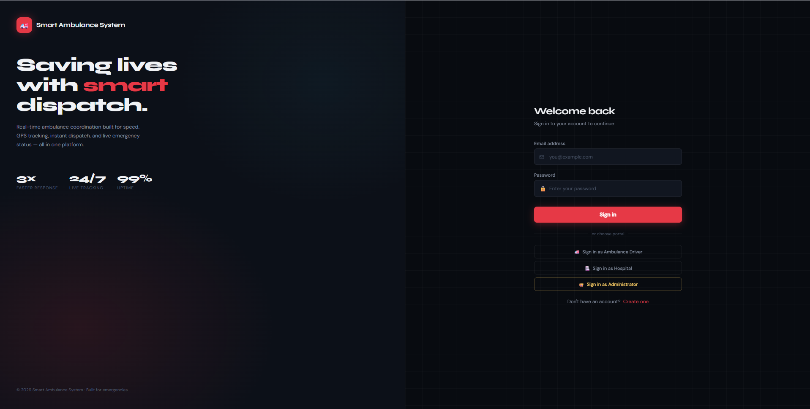
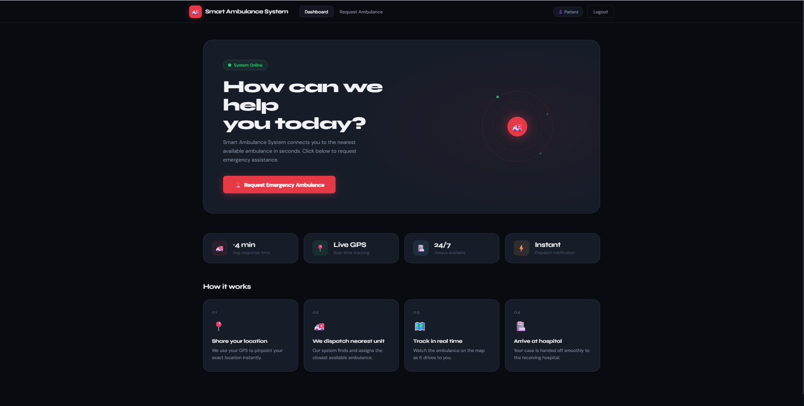
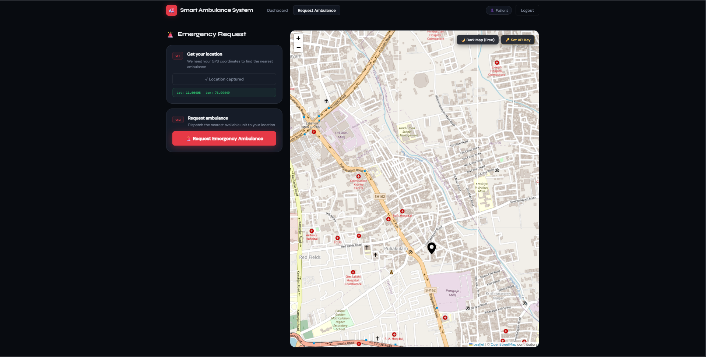
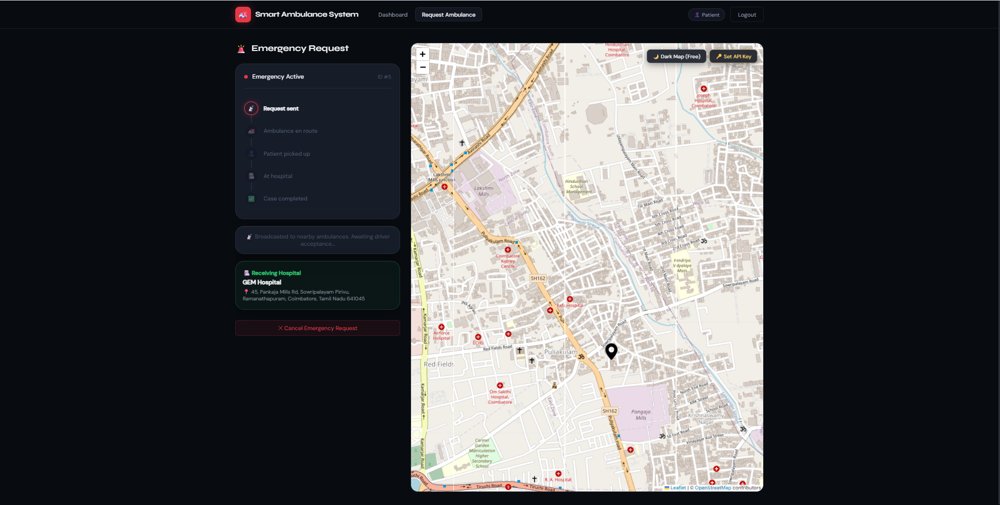
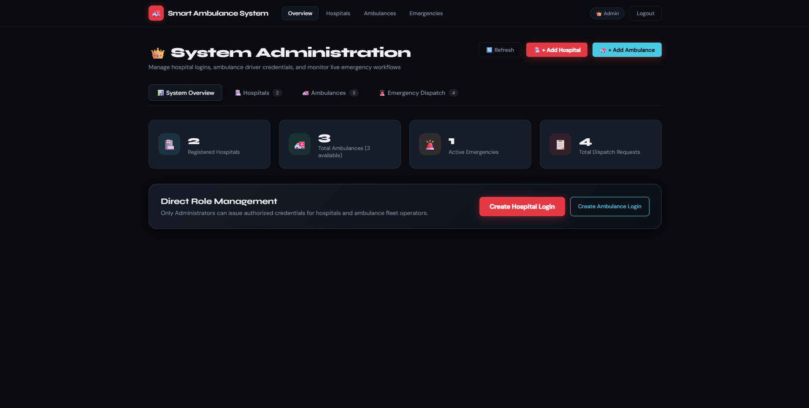
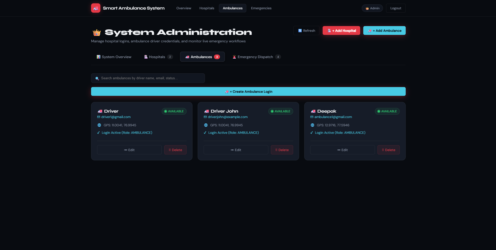
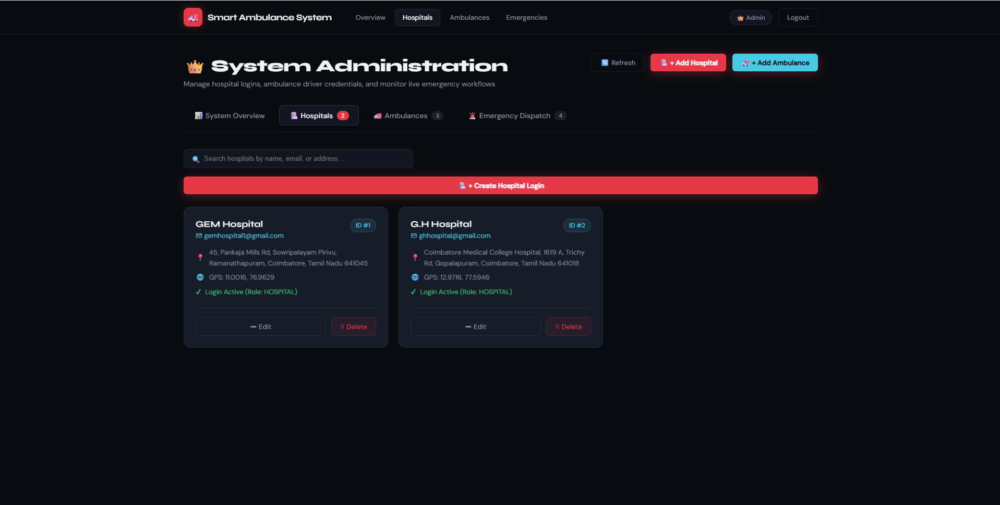
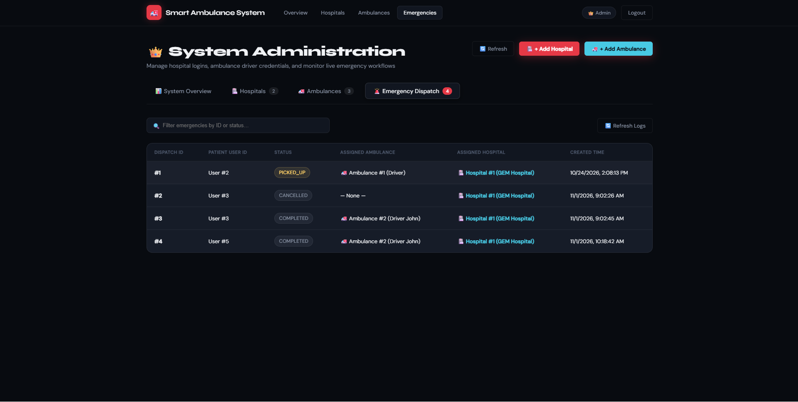
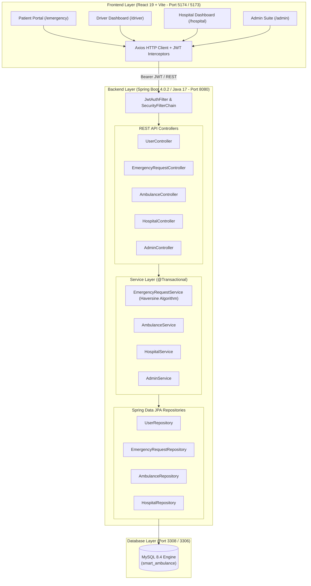
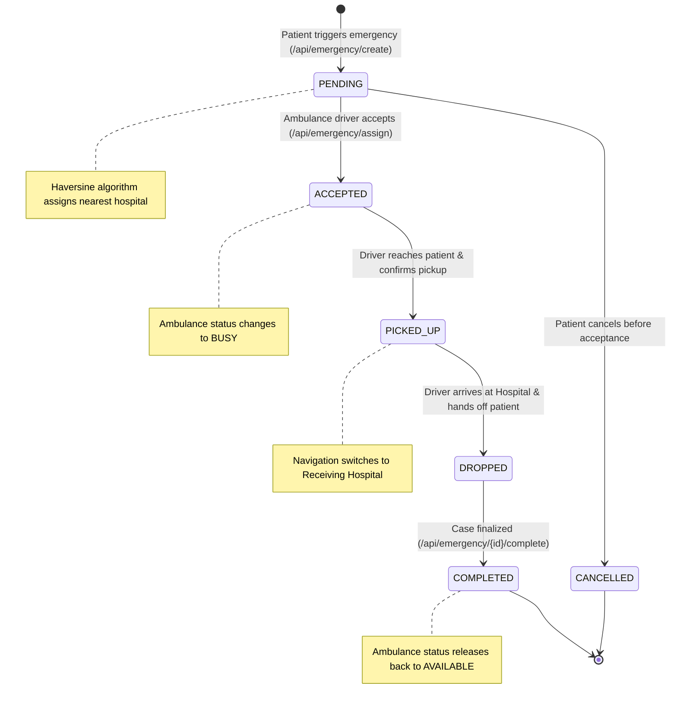

# Smart Ambulance System – Real-Time Emergency Healthcare Dispatch & Fleet Coordination

[](https://www.oracle.com/java/)
[](https://spring.io/projects/spring-boot)
[](https://react.dev/)
[](https://vitejs.dev/)
[](https://www.mysql.com/)
[](https://www.docker.com/)
[](https://leafletjs.com/)
[](https://jwt.io/)

Smart Ambulance System (SAS) is a full-stack web-based emergency healthcare dispatch and fleet coordination platform designed to eliminate critical response delays through automated GPS pinpointing, intelligent nearest-hospital binding, live telemetry tracking, and integrated triage workflows.

The system provides role-based access for patients, ambulance drivers, hospital personnel, and system administrators while maintaining complete dispatch traceability, operational integrity, and real-time geospatial coordination.

<table>
  <tr>
    <td width="50%"></td>
    <td width="50%"></td>
  </tr>
  <tr>
    <td width="50%"></td>
    <td width="50%"></td>
  </tr>
  <tr>
    <td width="50%"></td>
    <td width="50%"></td>
  </tr>
  <tr>
    <td width="50%"></td>
    <td width="50%"></td>
  </tr>
</table>

## Features

- User registration and authentication
- Stateless JWT authentication
- Role-Based Access Control (RBAC)
- Four user roles:
  - `ADMIN` — System configuration, fleet supervision, hospital management, and dispatch audit logs
  - `HOSPITAL` — Inbound triage monitoring, patient admissions, and historical case analytics
  - `AMBULANCE` — Dispatch reception, live GPS heartbeat broadcast, and two-stage navigation
  - `USER` — One-click GPS emergency dispatch, real-time live ambulance tracking, and case cancellation
- Real-time GPS coordinate acquisition via browser Geolocation API
- Interactive high-contrast Leaflet geospatial map with custom ambulance, patient, and hospital pins
- Automated nearest-hospital assignment using the Haversine spherical distance algorithm
- Real-time 5-stage emergency lifecycle progression tracking
- Two-stage smart turn-by-turn navigation (Patient pickup $\rightarrow$ Hospital delivery)
- Dynamic ambulance fleet availability management (`AVAILABLE` / `BUSY`)
- Real-time GPS heartbeat broadcasting for ambulance units
- Hospital triage dashboard with live inbound emergency visibility
- Administrative telemetry, system KPI counters, and fleet oversight
- Hospital onboarding, coordinate mapping, and capacity management
- Comprehensive end-to-end dispatch audit trail

---

## 🏗️ System Architecture



---

## 🔄 Emergency Lifecycle State Machine



---

## 🛠️ Tech Stack

| Domain | Technology | Version | Purpose |
|---|---|---|---|
| **Frontend Framework** | [React](https://react.dev/) | `19.2.0` | Declarative, component-based user interfaces |
| **Frontend Bundler** | [Vite](https://vitejs.dev/) | `7.3.3` | High-speed HMR dev server & optimized production build |
| **Routing** | [React Router DOM](https://reactrouter.com/) | `7.13.1` | Client-side routing with role-based route protection |
| **Mapping & Geospatial** | [Leaflet](https://leafletjs.com/) & [react-leaflet](https://react-leaflet.js.org/) | `1.9.4` / `5.0.0` | Map container, markers, popups, and smooth recentering |
| **HTTP Client** | [Axios](https://axios-http.com/) | `1.13.6` | Automatic JWT injection, response interceptors, and error normalization |
| **Backend Framework** | [Spring Boot](https://spring.io/projects/spring-boot) | `4.0.2` | Core application framework & dependency injection |
| **Language Runtime** | [Java JDK (Temurin)](https://adoptium.net/) | `17` | High-performance enterprise Java runtime |
| **Security & Auth** | Spring Security & JJWT | `0.11.5` | Stateless JWT authentication, BCrypt hashing, and RBAC |
| **ORM / Persistence** | Spring Data JPA / Hibernate | 7.x | Relational mapping, transaction boundaries, and schema management |
| **Database** | [MySQL](https://www.mysql.com/) | `8.4 LTS` | ACID-compliant relational storage |
| **API Documentation** | [Springdoc OpenAPI UI](https://springdoc.org/) | `3.1.1` | Automated OpenAPI 3.1 & interactive Swagger UI |
| **Containerization** | [Docker](https://www.docker.com/) & Compose | 24+ | Multi-container automated orchestration and isolated networking |

---

## 🔑 Default Login Credentials

The system initializes with ready-to-test accounts across all roles:

| Portal | Role | Email | Password | Access URL |
|---|---|---|---|---|
| **System Administrator** | `ADMIN` | `admin@smartambulance.com` | `Admin@123` | [`/admin-login`](http://localhost:5174/admin-login) |
| **Hospital Operations** | `HOSPITAL` | `gemhospital1@gmail.com` | *(configured by admin)* | [`/hospital-login`](http://localhost:5174/hospital-login) |
| **Ambulance Driver** | `AMBULANCE` | `driverjohn@example.com` | `Password@123` | [`/driver-login`](http://localhost:5174/driver-login) |
| **Patient / User** | `USER` | `patient1@example.com` | `Password@123` | [`/`](http://localhost:5174/) |

> **MySQL Database Credentials:**
> - **Host:** `localhost`
> - **Port:** `3308` (Docker container mapping) / `3306` (Internal container)
> - **Database:** `smart_ambulance`
> - **User:** `root`
> - **Password:** `Akash@2006`

---

## 📡 REST API Reference

Interactive Swagger documentation is available at:  
👉 **`http://localhost:8080/swagger-ui.html`** (or raw OpenAPI JSON at `/v3/api-docs`)

### 1. Authentication & Users
| Method | Endpoint | Access | Description |
|---|---|---|---|
| `POST` | `/api/users/register` | Public | Register new patient account |
| `POST` | `/api/users/login` | Public | Patient login & receive JWT token |

### 2. Emergency Management
| Method | Endpoint | Access | Description |
|---|---|---|---|
| `POST` | `/api/emergency/create?lat={lat}&lon={lon}` | `USER` | Create new emergency with auto nearest hospital binding |
| `GET` | `/api/emergency/my-active` | `USER` | Retrieve patient's current ongoing emergency |
| `PUT` | `/api/emergency/{id}/cancel` | `USER`, `ADMIN` | Cancel a pending emergency request |
| `GET` | `/api/emergency/pending` | `AMBULANCE`, `ADMIN` | List all unassigned emergencies awaiting response |
| `GET` | `/api/emergency/active` | `AMBULANCE`, `ADMIN` | List all active cases (`PENDING`, `ACCEPTED`, `PICKED_UP`, `DROPPED`) |
| `PUT` | `/api/emergency/assign/{reqId}/{ambId}` | `AMBULANCE` | Accept emergency and set ambulance status to `BUSY` |
| `PUT` | `/api/emergency/{id}/pickup` | `AMBULANCE` | Confirm patient pickup at location |
| `PUT` | `/api/emergency/{id}/drop` | `AMBULANCE` | Confirm patient arrival at hospital |
| `PUT` | `/api/emergency/{id}/complete` | `AMBULANCE` | Complete rescue case and restore ambulance to `AVAILABLE` |

### 3. Ambulance Fleet
| Method | Endpoint | Access | Description |
|---|---|---|---|
| `POST` | `/api/ambulance/register` | Public | Driver self-registration (coordinates optional) |
| `POST` | `/api/ambulance/login` | Public | Ambulance driver sign in |
| `PUT` | `/api/ambulance/location/{id}?lat={lat}&lon={lon}`| `AMBULANCE` | Periodic live GPS heartbeat update |
| `GET` | `/api/ambulance/id/{id}` | Public | Retrieve live ambulance coordinates & status |

### 4. Hospital Operations
| Method | Endpoint | Access | Description |
|---|---|---|---|
| `POST` | `/api/hospital/login` | Public | Hospital operations sign in |
| `GET` | `/api/hospital/emergencies` | `HOSPITAL` | List active emergency dispatches assigned to hospital |
| `GET` | `/api/hospital/completed` | `HOSPITAL` | Archive of completed patient cases |

### 5. System Administration
| Method | Endpoint | Access | Description |
|---|---|---|---|
| `POST` | `/api/admin/login` | Public | System Administrator authentication |
| `GET` | `/api/admin/stats` | `ADMIN` | Live system KPI counters (hospitals, fleet, dispatches) |
| `GET` | `/api/admin/emergencies` | `ADMIN` | Full system audit trail of all dispatch cases |
| `GET / POST` | `/api/admin/hospitals` | `ADMIN` | List all or onboard new hospital account |
| `GET / PUT / DELETE`| `/api/admin/hospitals/{id}` | `ADMIN` | Retrieve, update, or remove hospital account |
| `GET / POST` | `/api/admin/ambulances` | `ADMIN` | List all or onboard new ambulance driver account |
| `GET / PUT / DELETE`| `/api/admin/ambulances/{id}`| `ADMIN` | Retrieve, update, or remove ambulance unit |

---

## 🚀 Getting Started

### Prerequisites
- **Git**
- **Java 17 JDK** (Temurin or OpenJDK)
- **Node.js 18+** & npm
- **Docker & Docker Compose** (Optional for containerized run)

---

### Option 1: Docker Compose (Recommended)

Start the entire backend and MySQL infrastructure automatically:

```bash
# Clone the repository
git clone https://github.com/your-username/smart-ambulance-system.git
cd smart-ambulance-system

# Build and start Backend + MySQL containers
docker compose up -d --build
```

Start the frontend development server:

```bash
cd smart-ambulance-frontend
npm install
npm run dev
```

Open your browser at **`http://localhost:5173`** (or `http://localhost:5174`).

To stop the containers:
```bash
docker compose down
```

---

### Option 2: Manual Local Setup

#### 1. Database Setup
Create a MySQL database named `smart_ambulance`:
```sql
CREATE DATABASE smart_ambulance;
```

#### 2. Start the Backend
Verify database credentials in `smart-ambulance-backend/src/main/resources/application.properties`:
```properties
spring.datasource.url=jdbc:mysql://localhost:3306/smart_ambulance
spring.datasource.username=root
spring.datasource.password=your_mysql_password
```

Run the Spring Boot application using Maven:
```bash
cd smart-ambulance-backend
./mvnw clean spring-boot:run
```
*Backend will start on port `8080`.*

#### 3. Start the Frontend
```bash
cd smart-ambulance-frontend
npm install
npm run dev
```
*Frontend will start on port `5173` (or `5174`).*

---

## ⚙️ Environment Variables

### Backend (`application.properties` or Docker environment)
| Variable | Default Value | Description |
|---|---|---|
| `SPRING_DATASOURCE_URL` | `jdbc:mysql://localhost:3306/smart_ambulance` | JDBC connection URL |
| `SPRING_DATASOURCE_USERNAME` | `root` | Database username |
| `SPRING_DATASOURCE_PASSWORD` | `Akash@2006` | Database password |
| `SPRING_JPA_HIBERNATE_DDL_AUTO` | `update` | Schema auto-update policy |
| `SPRING_JPA_SHOW_SQL` | `true` | Log SQL queries to console |

### Frontend (`smart-ambulance-frontend/.env`)
| Variable | Default Value | Description |
|---|---|---|
| `VITE_API_BASE_URL` | `http://localhost:8080` | Backend API base URL |
| `VITE_CARTO_API_KEY` | *(empty / optional)* | CARTO Dark Matter API key |

---

## 🔐 Security & Architectural Highlights

- **Stateless JWT Tokens:** Authentication is entirely stateless using HMAC-SHA256 signed tokens containing user identity and role claims.
- **BCrypt Password Hashing:** All passwords are salted and hashed with BCrypt before persistence.
- **Permissive Development CORS:** Automatically handles cross-origin requests from both port 5173 and 5174 with credentials enabled.
- **Client-Side Route Protection:** Protected routes verify token validity and role authorization; unauthorized users are redirected to their portal.
- **Atomic Operations (`@Transactional`):** State transitions and fleet availability toggles execute within managed database transactions to prevent race conditions.
- **Automated Data Seeding:** [`DataInitializer`](smart-ambulance-backend/src/main/java/com/smartambulance/demo/config/DataInitializer.java) auto-provisions the default administrator account on first boot.

---

## 👨‍💻 Author & Acknowledgments

* **Lead Developer:** Akash ([@Akash](https://github.com/))
* **Institution:** Sri Krishna College of Technology (SKCT)
* **License:** MIT License — Open source for emergency healthcare innovation.
